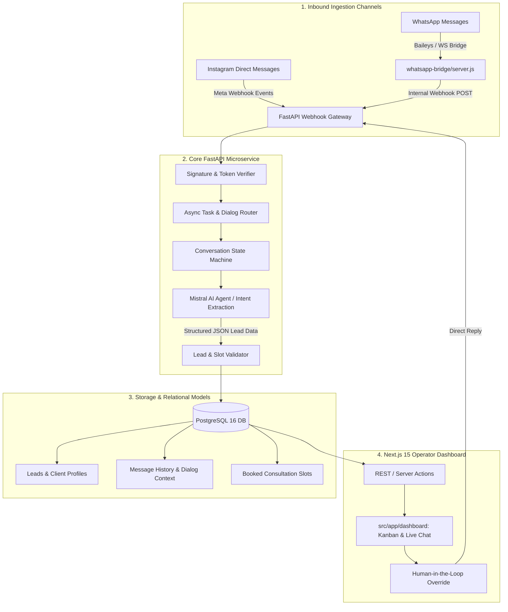

<div align="center">

# 🤖 INSTA CRM &mdash; AI-Powered Multi-Channel Lead & Booking Platform

**Automated conversational AI qualification, Instagram Direct & WhatsApp synchronization, and consultation booking platform.**

[](https://nextjs.org/)
[](https://fastapi.tiangolo.com/)
[](https://mistral.ai/)
[](https://www.postgresql.org/)
[](https://www.docker.com/)

</div>

---

## 📌 Overview

**INSTA CRM** is an end-to-end multi-channel conversational CRM engineered to automate client acquisition, consultation qualification, and appointment scheduling across **Instagram Direct Messages** and **WhatsApp**.

By integrating **Mistral AI** language models with real-time Meta webhooks, INSTA CRM autonomously interacts with prospective clients 24/7, extracts intent and contact information, checks calendar availability, and registers qualified leads into an interactive Next.js management dashboard.

---

## 🏗 System Architecture & Ingestion Flow



---

## 🚀 Key Modules & Capabilities

### 1. Autonomous AI Dialog Engine (`backend/app`)
- **Intent Recognition & Slot Filling:** Intelligently extracts user identity, budget, project goals, and preferred meeting times without rigid form-like friction.
- **Context Preservation:** Dynamically injects sliding-window conversation memory to maintain coherent multi-turn reasoning.
- **Fail-Safe Fallback:** Automatically flags complex queries for human operator intervention when confidence thresholds drop.

### 2. Dual-Channel Unified Messaging
- **Instagram Graph API:** Verifies SHA256 HMAC webhook payloads, parses direct messaging threads, and dispatches automated replies.
- **WhatsApp Bridge (`whatsapp-bridge/`):** Dedicated Node.js WebSocket microservice enabling instant WhatsApp communication without heavy third-party fees.

### 3. Next.js 15 Operational Suite (`frontend/`)
- Real-time lead progression pipeline (New $
ightarrow$ Qualified $
ightarrow$ Scheduled $
ightarrow$ Won).
- Live omnichannel conversation inspector with manual message override.
- Analytics charts tracking conversion rates, peak inquiry hours, and channel attribution.

---

## 💻 Tech Stack Breakdown

| Layer | Technologies | Key Features |
| :--- | :--- | :--- |
| **Frontend** | **Next.js 15, TypeScript, Tailwind CSS, Lucide** | Server-side rendering, responsive Kanban pipeline, high contrast dark theme |
| **Backend API** | **FastAPI (Python 3.11+), Pydantic v2, SQLAlchemy** | Asynchronous I/O, auto-generated OpenAPI / Swagger documentation |
| **AI / LLM** | **Mistral AI SDK** | Low-latency inference, function-calling structured output, cost efficiency |
| **Database** | **PostgreSQL 16** | Relational consistency for leads, chats, and audit trails |
| **Packaging & Dev** | **Docker Compose, uv** | Blazing-fast virtual environment management and containerized reproducibility |

---

## 📂 Repository File Structure

```plaintext
Automation/
├── backend/
│   ├── app/
│   │   ├── api/          # Webhook routers, lead endpoints, health checks
│   │   ├── core/         # Security configs, database sessions, environment settings
│   │   ├── models/       # SQLAlchemy relational schemas (Leads, Dialogs, Bookings)
│   │   └── services/     # Mistral AI agent, prompt templates, slot parsing logic
│   ├── tests/            # Pytest test suite for webhook verification & AI flows
│   ├── pyproject.toml    # uv package definition
│   └── uv.lock           # Locked dependency tree
├── frontend/
│   ├── src/
│   │   ├── app/          # Next.js 15 App Router pages (Dashboard, Leads, Settings)
│   │   └── components/   # UI components (Kanban board, Chat timeline, Metrics)
│   ├── package.json      # Frontend npm dependencies
│   └── tailwind.config   # Design system tokens and layout styles
├── whatsapp-bridge/
│   └── server.js         # Dedicated Node.js WhatsApp session bridge
├── docker-compose.yml    # Orchestration for PostgreSQL and microservices
└── README.md             # Project documentation
```

---

## ⚡ Quickstart & Local Setup

### 1. Clone & Configure
```bash
git clone https://github.com/Nekono3/Automation.git
cd Automation
cp .env.example .env
```

### 2. Start PostgreSQL via Docker
```bash
docker compose up -d postgres
```

### 3. Launch the Backend API
```bash
cd backend
uv venv .venv
source .venv/bin/activate  # On Windows: .venv\Scriptsctivate
uv pip install -e ".[dev]"
uvicorn app.main:app --reload --port 8000
```
Interactive Swagger docs: `http://localhost:8000/docs`

### 4. Launch the Next.js Frontend
```bash
cd ../frontend
npm install
npm run dev
```
Dashboard available at: `http://localhost:3000`

---

## 👨‍💻 Author

- **Belek Tazhibaev (Blake)** &mdash; Full-Stack & AI Systems Developer
- **GitHub:** [@Nekono3](https://github.com/Nekono3)
- **Telegram:** [@Chromatic_s](https://t.me/Chromatic_s)
- **Email:** [tazhibaev0909@gmail.com](mailto:tazhibaev0909@gmail.com)
