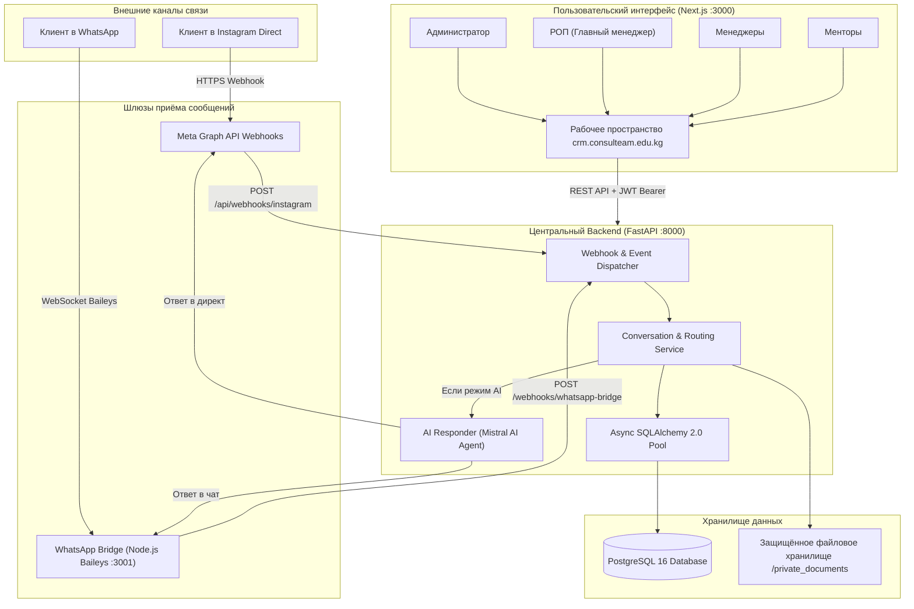
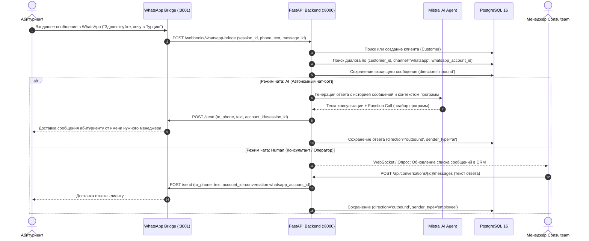
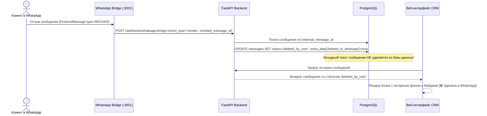
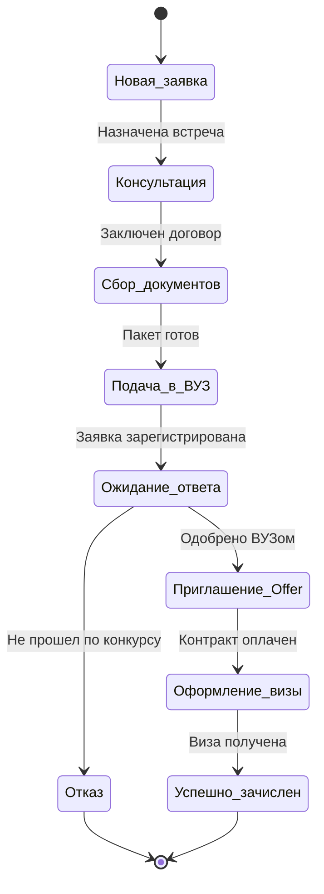
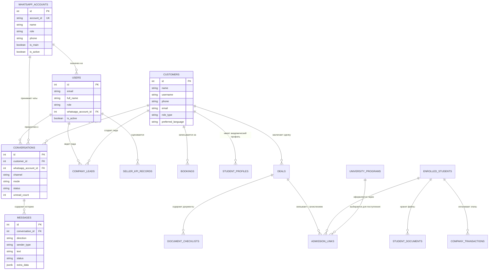

# 🎓 Consulteam CRM (INSTA CRM) — Полное руководство и документация проекта

> **Версия:** 2.4.0 (Production Release)  
> **Официальный домен:** [https://crm.consulteam.edu.kg](https://crm.consulteam.edu.kg)  
> **Сервер:** `2.26.50.235` (Ubuntu Linux 24.04 LTS / `/opt/insta`)  
> **Назначение:** Комплексная омниканальная CRM-система и AI-платформа для агентства международного образования Consulteam.

---

## 📑 Содержание

1. [Общее описание и назначение](#1-общее-описание-и-назначение)
2. [Архитектура системы и диаграмма потоков данных](#2-архитектура-системы-и-диаграмма-потоков-данных)
3. [Роли пользователей и матрица прав доступа (RBAC)](#3-роли-пользователей-и-матрица-прав-доступа-rbac)
4. [Омниканальный диалоговый модуль и маршрутизация](#4-омниканальный-диалоговый-модуль-и-маршрутизация)
   - [Последовательность обработки сообщений WhatsApp и Instagram](#последовательность-обработки-сообщений-whatsapp-и-instagram)
   - [Изоляция менеджеров и предотвращение путаницы номеров](#изоляция-менеджеров-и-предотвращение-путаницы-номеров)
   - [Механизм сохранения удалённых сообщений](#механизм-сохранения-удалённых-сообщений)
5. [Детальный разбор всех окон и разделов системы](#5-детальный-разбор-всех-окон-и-разделов-системы)
   - [1. Авторизация (`/`)](#1-авторизация-)
   - [2. Обзор и аналитика (`/dashboard`)](#2-обзор-и-аналитика-dashboard)
   - [3. Входящие диалоги (`/dashboard/conversations`)](#3-входящие-диалоги-dashboardconversations)
   - [4. Контакты и клиенты (`/dashboard/customers`)](#4-контакты-и-клиенты-dashboardcustomers)
   - [5. База лидов (`/dashboard/leads`)](#5-база-лидов-dashboardleads)
   - [6. Реестр студентов (`/dashboard/students`)](#6-реестр-студентов-dashboardstudents)
   - [7. Личное досье студента (`/dashboard/students/[id]`)](#7-личное-досье-студента-dashboardstudentsid)
   - [8. Поступления / Канбан-воронка (`/dashboard/pipeline`)](#8-поступления--канбан-воронка-dashboardpipeline)
   - [9. Каталог университетов и программ (`/dashboard/programs`)](#9-каталог-университетов-и-программ-dashboardprograms)
   - [10. KPI Продавцов (`/dashboard/kpi`)](#10-kpi-продавцов-dashboardkpi)
   - [11. Сотрудники и KPI (`/dashboard/team`)](#11-сотрудники-и-kpi-dashboardteam)
   - [12. Финансовый модуль (`/dashboard/finance`)](#12-финансовый-модуль-dashboardfinance)
   - [13. Консультации и записи (`/dashboard/bookings`)](#13-консультации-и-записи-dashboardbookings)
   - [14. Конструктор автоматизаций (`/dashboard/automations`)](#14-конструктор-автоматизаций-dashboardautomations)
   - [15. Мост WhatsApp и QR-подключение (`/dashboard/whatsapp`)](#15-мост-whatsapp-и-qr-подключение-dashboardwhatsapp)
6. [Структура базы данных и ER-диаграмма](#6-структура-базы-данных-и-er-диаграмма)
7. [AI-ассистент: Логика, промпты и инструменты](#7-ai-ассистент-логика-промпты-и-инструменты)
8. [Инфраструктура, развёртывание и эксплуатация](#8-инфраструктура-развёртывание-и-эксплуатация)

---

## 1. Общее описание и назначение

**Consulteam CRM** создана специально для автоматизации работы образовательного агентства полного цикла. Она объединяет маркетинговые каналы, консультации, сбор документов, подачу в зарубежные университеты (Турция, страны Европы, США, Кипр и др.), финансовый учёт и мотивацию сотрудников в рамках единого веб-пространства.

### Ключевые возможности:
* **Единый Inbox:** Одновременная работа с Instagram Direct и множеством независимых рабочих номеров WhatsApp.
* **Искусственный интеллект:** Автономный консультант на базе LLM (Mistral AI), свободно общающийся на кыргызском и русском языках.
* **Гарантия сохранности данных:** Клиентские удаления сообщений в WhatsApp больше не стирают историю — CRM сохраняет исходный текст с визуальным маркером удаления.
* **Разделение доступа:** Консультанты работают исключительно со своими чатами и видят личные показатели KPI, в то время как РОП и Администратор обладают глобальным контролем.

---

## 2. Архитектура системы и диаграмма потоков данных

Система построена на микросервисной архитектуре, оптимизированной под высокую скорость отклика и непрерывную работу.



---

## 3. Роли пользователей и матрица прав доступа (RBAC)

В системе реализовано 4 системные роли. Каждая роль адаптирует как поведение интерфейса (сайдбар, кнопки, фильтры), так и строгие ограничения на уровне серверных эндпоинтов.

| Раздел / Возможность | 👑 Администратор (`admin`) | 👔 РОП / Главный менеджер (`lead_manager`) | 🎧 Менеджер (`manager`) | 🎓 Ментор (`mentor`) |
| :--- | :---: | :---: | :---: | :---: |
| **Просмотр чатов** | Все каналы и номера | Все каналы и номера | **Только свой номер WhatsApp** | Только назначенные |
| **Отправка сообщений** | В любой чат | В любой чат | Только в свои чаты | В назначенные |
| **Глобальный тумблер AI** | Полный доступ | Полный доступ | Скрыт | Скрыт |
| **Управление баллами KPI** | Начисление / Удаление / Синхронизация | Начисление / Удаление / Синхронизация | **Только просмотр своего рейтинга** | Только просмотр |
| **Редактирование продавцов**| Да | Да | Заблокировано | Заблокировано |
| **Финансы и касса** | Полный доступ | Полный доступ | Скрыто в навигации | Скрыто в навигации |
| **Университеты и программы**| Просмотр и редактирование | Просмотр и редактирование | Просмотр и подбор | Просмотр и подбор |
| **Студенты и воронка** | Полный доступ | Полный доступ | Свои сделки и лиды | Ведение принятых дел |
| **Подключение QR WhatsApp**| Да | Да | Скрыто в навигации | Скрыто в навигации |
| **Сценарии автоматизаций** | Да | Да | Скрыто в навигации | Скрыто в навигации |

---

## 4. Омниканальный диалоговый модуль и маршрутизация

### Последовательность обработки сообщений WhatsApp и Instagram



### Изоляция менеджеров и предотвращение путаницы номеров

Ранее при наличии нескольких номеров WhatsApp возникал риск того, что при входящем сообщении на номер Менеджера 2 ответ отправлялся с номера Главного менеджера. В обновлении эта проблема ликвидирована на трёх уровнях:
1. **База данных:** Каждая запись `Conversation` содержит внешний ключ `whatsapp_account_id`. Диалог с клиентом на номере А и диалог с тем же клиентом на номере Б — это две строго изолированные сущности.
2. **AI Responder:** Функция `generate_and_send_ai_reply` считывает `conversation.whatsapp_account.account_id` и явно передаёт параметр `account_id` в мост.
3. **Ручная отправка:** При ответе оператора эндпоинт `/api/conversations/{id}/messages` передаёт сессионный ключ связанного с диалогом номера.

### Механизм сохранения удалённых сообщений

Когда пользователь нажимает в WhatsApp «Удалить у всех» (*Delete for everyone*), протокол Baileys отправляет специальное служебное событие:



---

## 5. Детальный разбор всех окон и разделов системы

### 1. Авторизация (`/`)
* **Интерфейс:** Лаконичная карточка в фирменных цветах Consulteam (тёмно-синий `#283876`, контрастный белый фон, логотип агентства).
* **Поля:** Электронная почта и пароль.
* **Функционал:** Аутентификация через `/api/auth/login`, получение JWT-токена, сохранение пользователя в `AuthContext`, редирект в `/dashboard`.

---

### 2. Обзор и аналитика (`/dashboard`)
* **Метрики верхнего уровня:**
  * Открытые диалоги (общее число).
  * Диалоги под управлением ИИ (с процентом от общего объема).
  * Диалоги на живых операторах.
  * Ожидающие консультации (записи на сегодня и ближайшие дни).
  * Всего уникальных контактов в базе.
  * Количество непрочитанных входящих сообщений.
* **Воронка конверсий:** Графическое отображение прохождения лидов от первого клика до подписания договора на обучение.

---

### 3. Входящие диалоги (`/dashboard/conversations`)
Главный операционный центр менеджеров и РОПа.

#### Панель глобального управления AI-ботом
* **Главный тумблер:** Позволяет моментально активировать ИИ-чат-бота на всех диалогах или перевести все чаты в режим живых консультантов.
* **Область действия:** Выбор каналов: «Все (WhatsApp + Insta)», «Только WhatsApp», «Только Instagram».
* **Информационный статус:** Отображает количество диалогов в очереди бота и сотрудников в реальном времени.

#### Левая панель (Список диалогов)
* **Поисковая строка:** Мгновенная фильтрация по имени, номеру телефона (`+996...`) или юзернейму Instagram.
* **Табы состояний:** «Все», «Открытые», «Непрочитанные», «AI-ассистент», «Без ответственного».
* **Канальные фильтры:** Выпадающий список с возможностью отфильтровать чаты конкретного менеджера WhatsApp (`🟢 WA: РОП`, `🟢 WA: Nursuluu`, `🟢 WA: Менеджер 3`).
* **Элемент списка:** Имя, аватар с индикатором соцсети, превью последней фразы, счётчик непрочитанных сообщений, бейдж привязанного номера WhatsApp, бейдж режима (ИИ / Консультант).

#### Центральная панель (Окно чата)
* **Верхняя строка диалога:** Имя контакта, канал, кнопки переключения режима конкретного диалога (`ИИ`, `Оператор`, `Пауза`), кнопка открытия карточки студента.
* **Лента сообщений:**
  * Сообщения клиента — выравнивание слева, светло-серые блоки.
  * Сообщения ИИ — фирменные сине-фиолетовые блоки с иконкой робота.
  * Сообщения сотрудника — изумрудные блоки с именем оператора.
  * **Удалённые сообщения:** Янтарная пунктирная рамка, цвет `#FFFBEB` и отметка: `[🗑️ Сообщение удалено в WhatsApp (сохранено в CRM)]`.
* **Поле ввода:** Отправка текстовых сообщений. В режиме «AI-ассистент» ввод блокируется с подсказкой о необходимости переключиться на консультанта во избежание рассинхронизации логики бота.

#### Правая панель (Инспектор студента)
* **Карточка контакта:** Имя, телефон, никнейм, ID в базе, язык коммуникации (RU / KY / EN), статус (Студент / Родитель).
* **Академический профиль:** Класс/курс, средний балл аттестата (GPA), наличие сертификатов (IELTS, TOEFL, TÖMER, SAT, YÖS), желаемые страны обучения и планируемый бюджет.
* **Теги и служебные заметки:** Быстрое добавление тегов и текстовых заметок, доступных коллегам.
* **Блок записей:** Просмотр назначенных консультаций с кнопками «Подтвердить» и «Отменить».

---

### 4. Контакты и клиенты (`/dashboard/customers`)
* Табличный реестр всех когда-либо написавших пользователей.
* Столбцы: Имя, Никнейм, Телефон, Email, Канал первого обращения, Дата последнего контакта, Назначенные теги.
* Возможность быстрого перехода в чат или открытия карточки клиента.

---

### 5. База лидов (`/dashboard/leads`)
* Специализированный реестр потенциальных клиентов на этапе квалификации.
* **Поля:** Источник лида (таргет, рекомендация, органика), категория интереса (Бакалавриат, Магистратура, Языковые курсы), ответственный менеджер, текущий статус, планируемая дата следующего контакта (*Next Action Date*).
* **Действие:** Кнопка «Конвертировать в дело» — переносит лида в активную воронку поступлений и создаёт связку с карточкой студента.

---

### 6. Реестр студентов (`/dashboard/students`)
* Полная база оформленных студентов Consulteam (синхронизирована с официальными данными компании).
* **Отображение:** Страна обучения (Турция, Германия, Польша, США, Кипр и др.), выбранный ВУЗ, специальность, статус оформления, номер контракта, финансовые показатели (Сумма контракта, Оплачено, Остаток), куратор.
* **Фильтрация:** По странам, статусам оплаты и курирующим менеджерам.

---

### 7. Личное досье студента (`/dashboard/students/[id]`)
* Индивидуальная страница конкретного студента:
  * **Связанные сущности:** Ссылка на профиль контакта, открытую сделку, выбранную университетскую программу и курирующего менеджера.
  * **Хранилище приватных документов:** Загрузка и просмотр файлов (аттестаты, паспорта, переводы, доверенности, фото). Доступ защищён токеном авторизации. Статусы проверки: `Не сдан`, `На проверке`, `Принят`, `Отклонен`.
  * **Финансовые этапы:** График платежей студента, привязанный к этапам договора, с фиксацией агентских и менеджерских комиссий.
  * **История изменений:** Хронологический лог всех правок и действий сотрудников по данному студенту.

---

### 8. Поступления / Канбан-воронка (`/dashboard/pipeline`)
Интерактивная доска стадий зачисления студента:



* Карточки можно перетаскивать между колонками. При смене колонки статус дела студента обновляется во всей системе автоматически.

---

### 9. Каталог университетов и программ (`/dashboard/programs`)
* Единая база международных университетов и факультетов.
* **Фильтры:** По странам, городам, языку преподавания (английский / турецкий / немецкий), форме обучения.
* **Параметры программ:** Годовая стоимость обучения, размер доступных скидок и стипендий (гранты от 25% до 100%), требования к GPA, перечень вступительных экзаменов (YÖS, SAT, IELTS).
* **Служебные заметки:** Дедлайны подачи документов и требования приёмной комиссии.

---

### 10. KPI Продавцов (`/dashboard/kpi`)
Еженедельная матрица оценки эффективности отдела продаж:

```
┌────────────────────────────────────────────────────────────────────────┐
│                      КАТЕГОРИИ И БАЛЛЫ KPI                            │
├──────────────────────────────────────┬────────────┬────────────────────┤
│ Категория                            │ Макс. балл │ Оценщик            │
├──────────────────────────────────────┼────────────┼────────────────────┤
│ 1. Дисциплина и ведение лид-базы     │ 10 баллов  │ РОП                │
│ 2. Созвоны (2) и встречи в офисе (3) │ 40 баллов  │ РОП                │
│ 3. Продажи (минимум 2 в неделю)      │ 50 баллов  │ РОП                │
│ 4. Командные собрания и планерки     │ 10 баллов  │ РОП                │
│ 5. Инновации и предложения компании  │ 50 баллов  │ Руководство        │
├──────────────────────────────────────┴────────────┴────────────────────┤
│ ИТОГО ВОЗМОЖНО: 160 баллов в неделю                                    │
└────────────────────────────────────────────────────────────────────────┘
```

* **Безопасность:** Менеджеры видят исключительно свои баллы в режиме просмотра. Кнопки добавления продавцов, начисления баллов и синхронизации с Google Таблицами доступны только РОПу и Администратору.

---

### 11. Сотрудники и KPI (`/dashboard/team`)
* Реестр штатных сотрудников компании.
* Назначение ролей, отделов и привязка персональных номеров WhatsApp.
* Месячные плановые и фактические показатели.
* **Аналитика WhatsApp:** Автоматический подсчёт отправленных сообщений сотрудником вручную в сравнении с объёмом, обработанным ИИ-ботом.

---

### 12. Финансовый модуль (`/dashboard/finance`)
* Мультивалютная касса (USD, KGS, EUR, TRY). Разные валюты не суммируются без явной конвертации во избежание искажения бухгалтерских данных.
* Учёт приходов (оплаты студентов по договорам) и расходов (агентские вознаграждения, визовые сборы, переводы, реклама).
* Привязка транзакций к конкретному студенту и этапу поступления.
* Механизм сторнирования: ошибочно внесенные платежи помечаются как аннулированные с указанием причины, сохраняя прозрачную историю аудита.

---

### 13. Консультации и записи (`/dashboard/bookings`)
* Календарная сетка консультаций (офлайн в офисе Consulteam в Бишкеке либо онлайн через видеосвязь).
* Статусы: `Черновик`, `Ожидает подтверждения`, `Подтверждена`, `Завершена`, `Отменена`.
* Быстрое подтверждение встречи и отправка автоматического уведомления абитуриенту.

---

### 14. Конструктор автоматизаций (`/dashboard/automations`)
* Настройка триггеров:
  * Приветственное сообщение новому контакту.
  * Реакция на ключевые слова («Турция», «цена», «магистратура», «адрес»).
  * Эмуляция задержки ответа (typing delay) для реалистичности общения.
* Включение/выключение триггеров переключателями без перезагрузки бэкенда.

---

### 15. Мост WhatsApp и QR-подключение (`/dashboard/whatsapp`)
* Управление мультиаккаунтным мостом WhatsApp:
  * Карточки подключенных аккаунтов (`РОП`, `Nursuluu`, `Менеджер 3`).
  * Генерация динамического QR-кода прямо в веб-интерфейсе для авторизации через смартфон.
  * Индикация статуса сессии в реальном времени (`Connected` / `Connecting` / `Disconnected`).
  * Кнопки мягкого перезапуска сессии и безопасного выхода из аккаунта.

---

## 6. Структура базы данных и ER-диаграмма

Вся информация хранится в PostgreSQL 16. Ниже представлена схема основных таблиц и их взаимосвязей.



---

## 7. AI-ассистент: Логика, промпты и инструменты

AI-ассистент Consulteam разработан на базе модели **Mistral AI** и выполняет роль квалифицированного консультанта первого контакта.

### Поведение и правила бота:
1. **Языковая адаптивность:** Бот автоматически определяет язык собеседника (кыргызский или русский) и отвечает на том же языке с сохранением профессионального тона.
2. **Поэтапная квалификация:** Вместо отправки длинных опросников бот задаёт по 1–2 естественных вопроса:
   * Какая страна вас больше интересует? (Турция, страны Европы, США, Кипр)?
   * На какую специальность планируете поступать (IT, медицина, бизнес, инженерия)?
   * В каком вы сейчас классе / на каком курсе?
   * Сдавали ли языковые тесты (IELTS, TÖMER, TOEFL)?
3. **Вызов инструментов (Function Calling):**
   * `search_university_programs`: поиск программ в базе по стране, бюджету и направлению.
   * `get_available_consultation_slots`: запрос доступного времени для встречи в офисе или онлайн.
   * `create_consultation_booking`: фиксация бронирования в календаре CRM.
4. **Контекстная память:** Бот учитывает последние 15 сообщений диалога, сохраняя нить разговора даже при паузах клиента.
5. **Мягкая эскалация:** При сложных нестандартных вопросах бот вежливо сообщает, что передаёт диалог старшему эксперту агентства, и переводит диалог в режим `human`.

---

## 8. Инфраструктура, развёртывание и эксплуатация

### Сервер и окружение
* **IP-адрес сервера:** `2.26.50.235`
* **Пользователь SSH:** `root`
* **Рабочая директория проекта:** `/opt/insta`

### Системные службы systemd

```bash
# Проверка статуса всех компонентов
systemctl status insta-backend
systemctl status insta-frontend
systemctl status insta-whatsapp-bridge
systemctl status caddy

# Перезапуск сервисов после обновления кода
systemctl restart insta-backend insta-frontend insta-whatsapp-bridge
```

### Порты и маршрутизация Caddy
* `80` / `443` — Внешний веб-сервер Caddy (автоматический SSL для `crm.consulteam.edu.kg`).
* `3000` — Внутренний порт Next.js Frontend.
* `8000` — Внутренний порт FastAPI Backend.
* `3001` — Внутренний порт WhatsApp Baileys Bridge.
* `5432` — Локальная СУБД PostgreSQL 16.

### Резервное копирование базы данных
Для создания резервной копии всей CRM выполните на сервере:

```bash
pg_dump -U insta_user -d insta_crm -F c -b -v -f /opt/insta/backup_$(date +%Y%m%d_%H%M%S).dump
```

---

> Документация подготовлена для агентства **Consulteam**. Система полностью развёрнута и готова к ежедневной работе.
