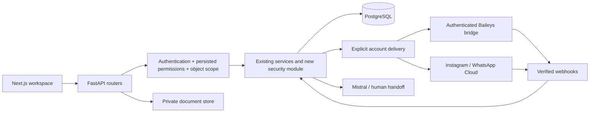

# Current state — security iteration, 2026-11-05

Source: existing `/home/nekono3/INSTA`, baseline commit `c809b63`, following the deployed company workspace. No new ZIP was attached to this iteration. User-generated untracked manuals/static files were left untouched. This document supersedes security assumptions in the historical full guide.

## Evidence and scope

The baseline contained 25 SQLAlchemy tables and 22 passing pytest tests. The baseline had Next.js **16.4.0** and React **19.3.0**, not Next.js 15. This branch patches Next.js and eslint-config-next to **16.4.5** after the critical dependency finding. Backend is Python/FastAPI/SQLAlchemy/PostgreSQL. Caddy/systemd serve the existing deployment. The additive security schema brings the model total to 37 tables. A read-only VPS inspection found bridge listening on `0.0.0.0:3001`; this is a listening configuration, **not** a confirmation that the firewall permits Internet access. VPS Python package versions observed: FastAPI 0.142.2, SQLAlchemy 2.1.3, Alembic 1.20.0, Pydantic 2.13.5, asyncpg 0.32.0. Bridge dependency versions were copied from its installed production package manifest without changing production.

No production code, database, secrets, sessions or service configuration was changed in this iteration. Live WhatsApp/Instagram sends and actual Meta app permissions were not exercised.

## Module status

| Module | Status | Evidence / limit |
|---|---|---|
| Baseline customer/deal/booking/finance/KPI flows | Implemented and verified locally | Original regression tests retained; no live-provider claim |
| RBAC, six roles, teams and object access | Implemented and verified locally | Database grants, API policy inventory, negative access tests; legacy role aliases during transition |
| Invitations/password reset/JWT | Implemented and verified locally | Single-use hashed tokens, short access tokens, password-change session invalidation; MFA/refresh sessions remain future work |
| Bridge service auth + strict account routing | Implemented and verified locally | Node guard/routing tests and Python transport tests; real session pairing/sends unverified |
| Instagram Direct / comment-to-DM | Implemented; provider unverified | Signatures and sequential comment deduplication tested with synthetic events and mocked provider transport; actual app scopes/private-reply limits unverified |
| Private student documents | Partially implemented | Assignment authorization, bounded content checks, private downloads tested; versioning/reviewer workflow still phase 4 |
| Student admissions | Partially implemented | Existing links and stages retained; independent multiple applications/handoff/visa model not added yet |
| University catalog | Implemented and verified locally | Existing programs preserved; operations role can edit, managers cannot; expanded Knowledge Base remains future work |
| KPI | Partially implemented | Legacy 160-point history retained; configurable employee metrics retained; seller-to-user ownership and mentor templates pending |
| Finance | Partially implemented | Exact journal/void preserved and permission protected; accrual/transit/liabilities/payroll/debts not yet modeled |
| Tasks/notifications/portal | Missing | Bookings exist; general tasks, notifications and student identity are not claimed implemented |
| Frontend permissions | Partially implemented | Permission-driven navigation/landing and delivery failure UI; six distinct dashboards and full RU/KY localization remain phase 8 |
| Migrations/restore | Implemented and verified on synthetic databases | Frozen baseline + additive migration; pg_dump/restore round trip tested; production restore not tested |

## Dependency map

Business links remain `Customer → LeadRecord / Deal → AdmissionLink → EnrolledStudent`, with finance and documents referencing student IDs. New security tables add grants, team membership and assignment history rather than replacing these entities. Existing `User.whatsapp_account_id` is an explicit account binding, not an inferred mapping of account_1/2/3 to employee names.

See API_MAP.md for every discovered operation, PERMISSIONS.md for scopes, and BACKLOG.md for remaining acceptance criteria. Test evidence is recorded in docs/development/TESTING.md.
